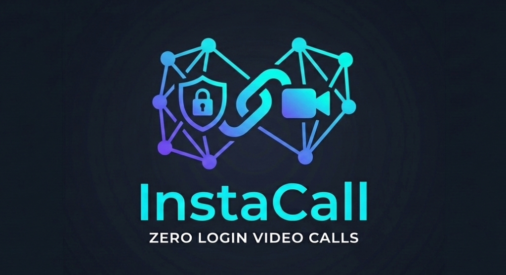

# 👻 GhostCall — WhatsApp Web Edition

> **Zero Login, Zero Database, Instant Multi-Party WebRTC Video Calling**  
> Redesigned with **WhatsApp Web's exact visual style, layout structure, color schemes, typography, and iconography**.

GhostCall is a lightning-fast, ultra-private group video calling web application that requires no login, no accounts, and no backend database. Built with pure browser WebRTC mesh networking powered by [PeerJS](https://peerjs.com/), it enables you to create or join private encrypted video rooms instantly via simple 6-digit codes or direct invite links, featuring an authentic WhatsApp Web split-screen interface with in-call chat, participant status tracking, and HD video streaming.



---

## 🎨 WhatsApp Web UI & Design System

The application strictly adheres to WhatsApp Web's dark theme design system:

- **Color Palette**:
  - Primary Dark App Background: `#111b21`
  - Panels, Sidebars & Header: `#202c33`
  - Hover States & Card Insets: `#2a3942`
  - Border & Dividers: `#222d34`
  - WhatsApp Brand Green: `#00a884` (Active buttons, badges, speaking indicator)
  - Outgoing Chat Bubble: `#005c4b` (with `#53bdeb` blue double checks `✓✓`)
  - Incoming Chat Bubble: `#202c33`
  - Text Colors: `#e9edef` (Primary), `#8696a0` (Secondary / timestamps / icons)
  - Prominent End Call: `#ef4444`
- **Split-Screen Layout Architecture**:
  - **Left Sidebar**: 380px WhatsApp sidebar on desktop featuring:
    - User profile header with live connection status
    - Tabbed navigation: **Chats** (with unread message badge) and **People** (participant list with real-time mic/cam status and speaking waves)
    - Full in-call messaging thread with end-to-end encryption banner, message timestamps, and WhatsApp input bar
    - Room Code card with 1-click URL copy and WhatsApp share button
  - **Right Main Stage**: Full-stage video canvas featuring:
    - Dynamic auto-adjusting video grid for 1-on-1 and multi-party calls
    - Active speaker detection with WhatsApp emerald border glow (`#00a884`)
    - Circular WhatsApp avatar fallbacks with participant initials when camera is off
    - Muted mic slash badge indicators on video tiles
    - Floating pill-shaped call controls dock (`bg-[#111b21]/88` with backdrop blur)
    - Draggable Picture-in-Picture (PiP) self-view card with corner snapping and double-click expand
  - **Responsive Tablet & Mobile Mode**:
    - Automatically collapses into a single-column layout on smaller screens
    - Sidebar transitions smoothly into an off-canvas slide-out drawer accessible via the floating dock or stage button

---

## ⚡ Core Bug Fixes & WebRTC Architectural Upgrades

1. **Eliminated Brittle WebSocket Probing**:
   - Replaced fragile raw WebSocket probes (`checkRoomExists`) that caused false "Room Doesn't Exist" timeouts on direct links. Any valid 6-digit link `#room-XXXXXX` allows instant, zero-login entry.
2. **Deterministic Glare-Free Full Mesh**:
   - Every peer establishes both a MediaConnection and a DataConnection with every other peer using deterministic ID ordering (`myPeerId > remotePeerId`), preventing call glare, collision loops, and duplicate video cards.
   - If the room host leaves or reloads, guests remain connected directly via peer-to-peer data channels and media calls without the room collapsing.
3. **Ghost / Phantom Room Elimination on Reload**:
   - Browser tabs generate a unique session identifier (`sessionUid`) to avoid PeerJS ID collisions.
   - Synchronous `beforeunload` / `pagehide` listeners broadcast `PEER_LEFT` and destroy the peer session immediately, eliminating 30-second stale phantom cards.
4. **Resilient Media Constraints & Progressive Fallbacks**:
   - Graceful progressive degradation: 1080p Studio $\rightarrow$ 720p HD $\rightarrow$ Basic video $\rightarrow$ Audio only $\rightarrow$ Fallback dummy canvas stream (preventing unhandled promise rejections and allowing WebRTC negotiation even if permissions are initially pending).
5. **Memory Leak Patches**:
   - Web Audio API analysers (`AudioContext`, `createMediaStreamSource`, `createAnalyser`) are properly disconnected on peer exit and room teardown.
   - Event listeners and animation loops are guarded and cleaned up.
6. **Reliable Track Replacement**:
   - Video track replacement for Screen Sharing and Mobile Camera Flip safely matches video senders even when tracks are muted or null.

---

## ⌨️ Global Keyboard Shortcuts

| Shortcut | Action |
|:---:|:---|
| **M** | Toggle Microphone (Mute / Unmute) |
| **V** | Toggle Camera (Turn Video On / Off) |
| **S** | Toggle Screen Sharing |
| **C** | Toggle WhatsApp Left Sidebar (Chat / People) |
| **F** | Toggle Full Screen Mode |
| **Esc** | Close active modals / dismiss focus |

---

## 💻 Local Testing & Verification

GhostCall requires no database, no Node.js build step, and no environment variables. Run any local static HTTP server from the project directory:

### Option 1: Python HTTP Server
```bash
python -m http.server 8000
```
Then open `http://localhost:8000` in your browser.

### Option 2: Node.js Serve / NPX
```bash
npx serve .
```

### Multi-Peer Verification Steps:
1. Open `http://localhost:8000` in **Window 1** (or Chrome).
2. Enter a display name (e.g. *Alice*) and click **"Start Video Call Now"**.
3. Allow camera/microphone access. Your room code (e.g. `582910`) and URL hash `#room-582910` are generated.
4. Open an Incognito window or a second browser (e.g. Edge / Firefox) at the same URL or direct link: `http://localhost:8000/#room-582910`.
5. Enter a display name (e.g. *Bob*).
6. Verify:
   - Video feeds connect immediately with low latency.
   - Active speaker detection highlights the speaking participant with a WhatsApp green ring.
   - Muting audio or stopping video updates the remote card with a muted mic badge or WhatsApp avatar.
   - In-call chat sends real-time messages with timestamps and blue double checkmarks (`✓✓`).
   - Screen sharing replaces the video stream smoothly across peers.
   - Closing one tab immediately removes the participant tile on the remaining tab without phantom delay.

---

## 🚀 Deployment (Vercel)

Deploy to Vercel in 1 click (static zero-configuration):

```bash
npx vercel
```
Or import into [vercel.com](https://vercel.com/new). No build commands or backend services required.