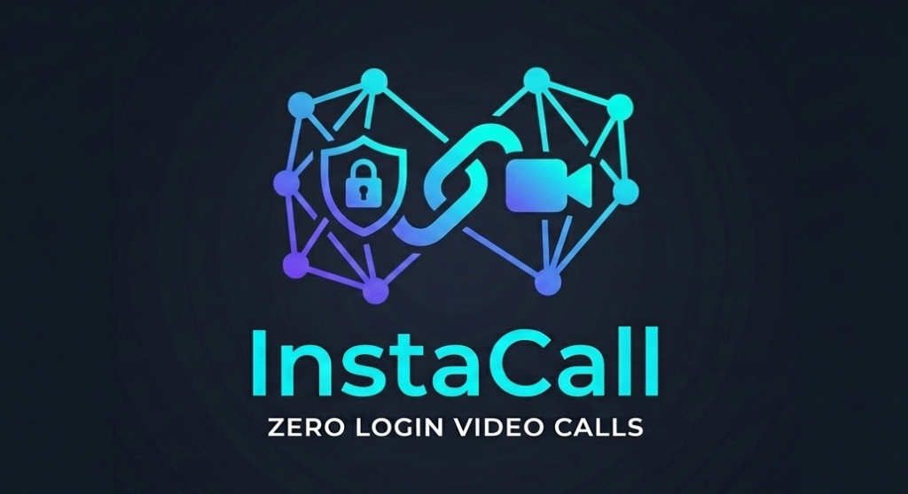

# 👻 GhostCall

> **Zero Login, Zero Database, Instant Multi-Party WebRTC Video Calling**  
> Simple, private, and designed for everyone — from kids to grandparents.

Lightning-fast, secure group video calling web app that requires no login, no registration, and no database. Built with WebRTC, it lets you create or join a private video room instantly via a simple link, supporting multi-party peer-to-peer calls with complete data privacy.



## ✨ Features

- **No Logins & No Accounts**: No passwords to remember or credentials to provide. Just jump in and talk.
- **Mesh Peer-to-Peer Architecture**: Direct browser-to-browser WebRTC connection powered by [PeerJS](https://peerjs.com/) and public STUN servers (`stun.l.google.com:19302`).
- **Multi-Party Group Calls**: Supports 3 to 6 participants per room with dynamic auto-adjusting video tile grids.
- **Easy Room Sharing**: 1-click room creation generates a 6-digit room code and direct URL hash (e.g., `#room-582910`) ready to share on WhatsApp or SMS.
- **Essential Controls**:
  - 🎙️ Mute / Unmute Microphone
  - 📹 Turn Camera On / Off
  - 💻 Screen Sharing with live track replacement
  - 📋 One-tap room link copying
  - 🔴 Clean call exit with instant rejoin option
- **Light & Accessible UI**: Clean, human-crafted design with soft emerald accents, high-contrast text, and simple navigation.
- **Vercel & Static Host Ready**: Pre-configured `vercel.json` with clean URLs and security headers.

---

## 🚀 Live Deployment (Vercel)

GhostCall has zero backend dependencies. To deploy:

1. Import this repository into [Vercel](https://vercel.com/new).
2. Click **Deploy** (no build command or environment variables required).

Or deploy via terminal:
```bash
npx vercel
```

---

## 💻 Local Development

Run any static HTTP server in the repository root:

```bash
# Python
python -m http.server 8000

# or Node.js
npx serve .
```

Open `http://localhost:8000` in your browser.

---

## 🛠️ Tech Stack

- **HTML5 & CSS3** (Vanilla, responsive CSS Grid and Flexbox)
- **Vanilla JavaScript (ES6+)**
- **WebRTC & PeerJS** (Signaling and P2P Mesh data/media streams)
- **Google STUN** (`stun:stun.l.google.com:19302`) for NAT traversal
